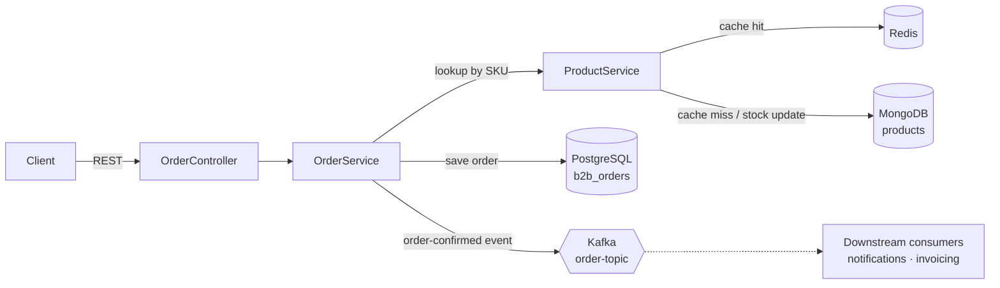

# B2B E-Commerce Order Backend

A Spring Boot backend for business-to-business ordering. Buyers place bulk orders against a product catalog: stock is checked and decremented, the order is priced and stored, and an order-confirmed event is published to Kafka for downstream services such as notifications, invoicing or analytics.

Each kind of data lives in the store that suits it: **PostgreSQL** for orders, **MongoDB** for the product catalog, **Redis** for caching hot product lookups, and **Kafka** for events.

## Tech stack

| Concern | Technology |
|---|---|
| Language / framework | Java 21, Spring Boot 3.4 |
| Orders (relational) | PostgreSQL 15, Spring Data JPA |
| Product catalog (documents) | MongoDB, Spring Data MongoDB |
| Cache | Redis, Spring Cache (`@Cacheable`) |
| Events | Apache Kafka (Spring for Apache Kafka) |
| Validation | Jakarta Bean Validation |
| Infrastructure | Docker Compose |

## Architecture



### Order flow

1. `POST /api/orders` validates the request (buyer name and SKU required, quantity of at least 1). Invalid fields come back as a `400` with one message per field.
2. The product is fetched by SKU. Repeat lookups are served from Redis, and every save refreshes the cached entry (`@CachePut`), so stock levels are never stale.
3. If stock is insufficient, the request is rejected with `400 Insufficient Stock`.
4. Otherwise, stock is decremented in MongoDB, the total is computed (`price × quantity`), and the order is saved to PostgreSQL with status `CONFIRMED`.
5. An `Order #<id> confirmed` event is published to the `order-topic` Kafka topic. Other services can react to it asynchronously without the order API waiting on them.

## API

| Method | Endpoint | Description |
|---|---|---|
| POST | `/api/products` | Add a product to the catalog |
| GET | `/api/products` | List the catalog |
| GET | `/api/products/{sku}` | Get one product (cached in Redis) |
| POST | `/api/orders` | Place an order |
| GET | `/api/orders` | List all orders |
| GET | `/api/orders/search?name=<buyer>&page=0&size=10` | Paginated orders for a buyer |

**Example:**

```bash
curl -X POST http://localhost:8080/api/orders \
  -H "Content-Type: application/json" \
  -d '{"buyerName":"Sharma Traders","productSku":"SKU-1001","quantity":50}'
```

```json
{
  "id": 1,
  "buyerName": "Sharma Traders",
  "productSku": "SKU-1001",
  "quantity": 50,
  "totalAmount": 12500.0,
  "status": "CONFIRMED",
  "orderDate": "2026-10-11T14:05:12"
}
```

## Running locally

**Requirements:** Java 21 and Docker.

1. Start PostgreSQL, MongoDB, Redis, Kafka and ZooKeeper:
   ```bash
   docker compose up -d
   ```
2. Run the app:
   ```bash
   ./mvnw spring-boot:run
   ```
   The API starts on `http://localhost:8080`. Connection settings are in `src/main/resources/application.properties`, and the defaults match `docker-compose.yml`.
3. Add a product to the catalog:
   ```bash
   curl -X POST http://localhost:8080/api/products \
     -H "Content-Type: application/json" \
     -d '{"name":"Industrial Gloves (box of 100)","sku":"SKU-1001","price":250.0,"stockQuantity":1000}'
   ```
   Then place an order with the example above.
4. Watch the order events:
   ```bash
   docker compose exec kafka kafka-console-consumer \
     --bootstrap-server localhost:9092 --topic order-topic --from-beginning
   ```

## Project structure

```
src/main/java/com/example/b2b_ecommerce
├── Models/       Order (JPA entity, PostgreSQL) and Product (MongoDB document)
├── controllers/  REST endpoints
├── repository/   JPA and Mongo repositories (derived queries, pagination)
├── service/      order placement, stock checks, caching, Kafka publishing
└── exception/    global exception handler
```

## Design notes

- **Why two databases:** orders are structured, relational records that need transactions and reporting, so they go in PostgreSQL. Catalog items vary in attributes from product to product, which suits MongoDB's flexible documents.
- **Why Kafka:** publishing an event keeps order placement fast and decoupled. Notification or invoicing services can be added as consumers without changing the order API.
- **Consistency:** stock lives in MongoDB and orders in PostgreSQL, so a single database transaction can't cover both. A production version would use the transactional outbox pattern, or a saga with a compensating stock restore, for guaranteed consistency.

## Roadmap

- A Kafka consumer service for order notifications
- Transactional outbox for reliable event publishing
- Optimistic locking on stock to prevent overselling under concurrent orders
- Swagger/OpenAPI documentation and Testcontainers integration tests
